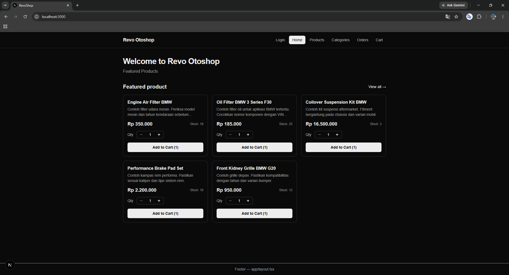
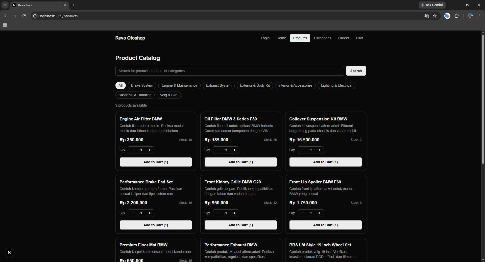
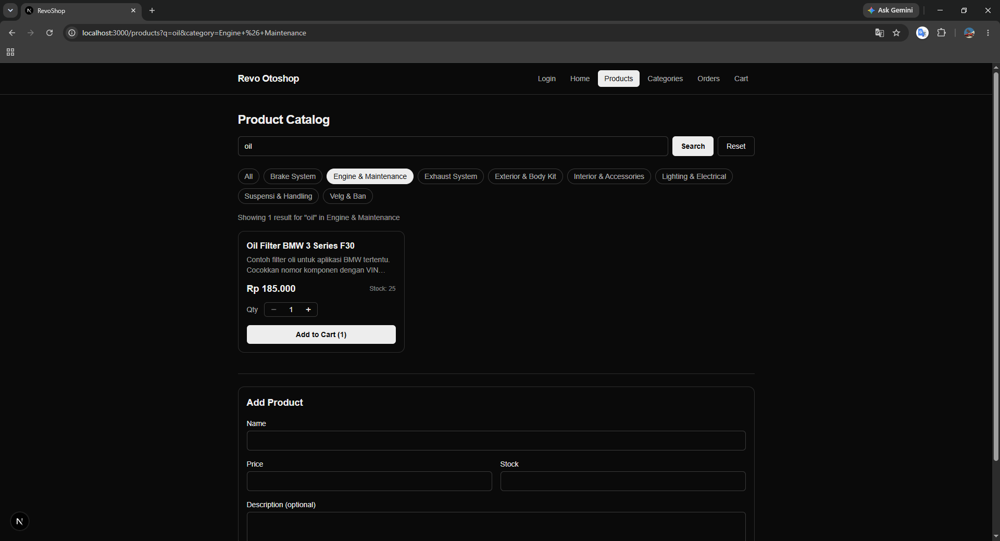
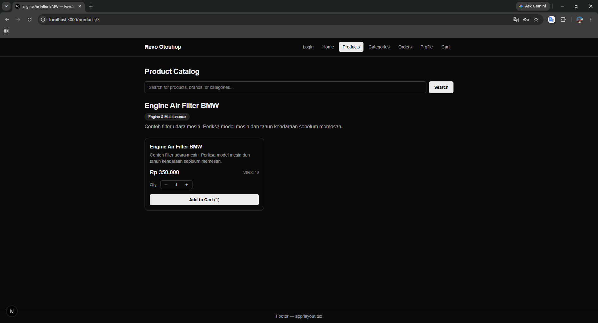
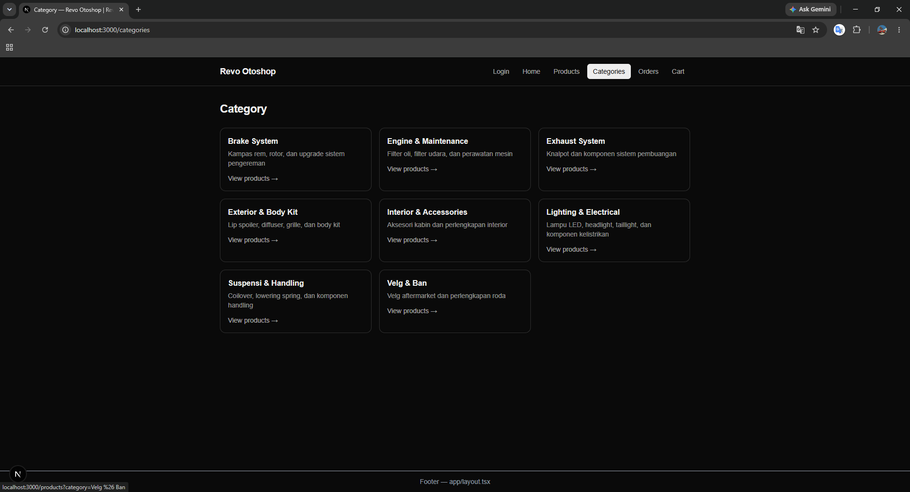
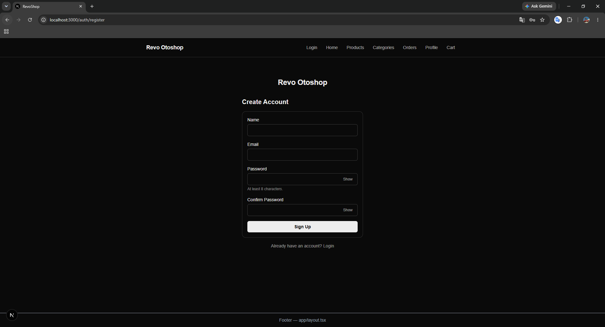
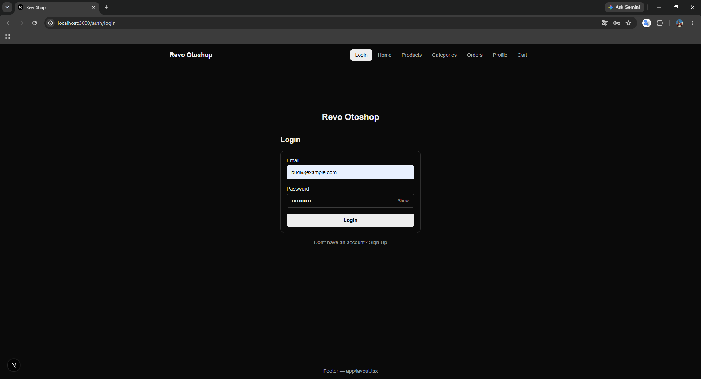
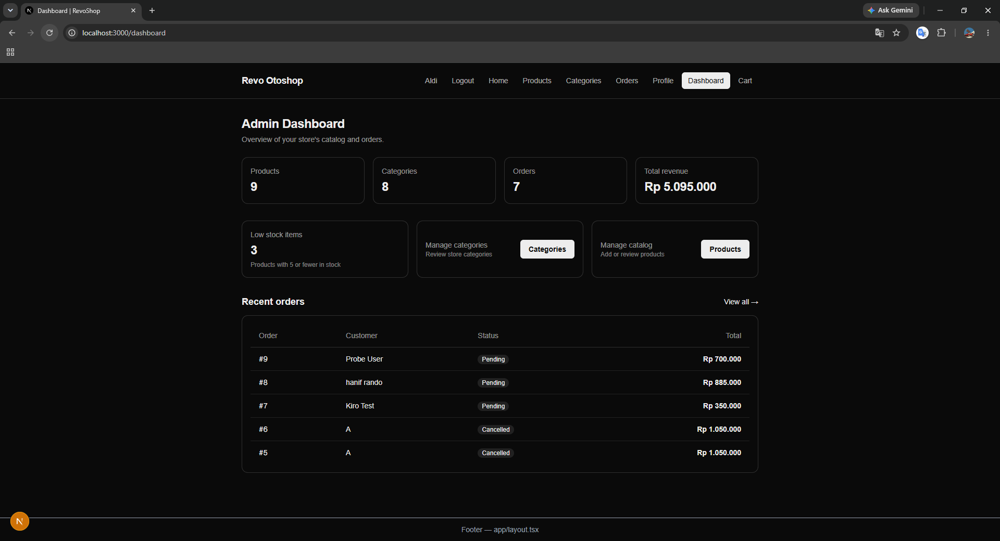
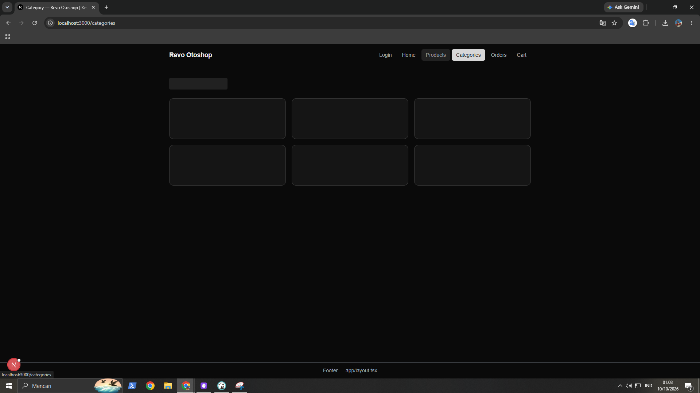
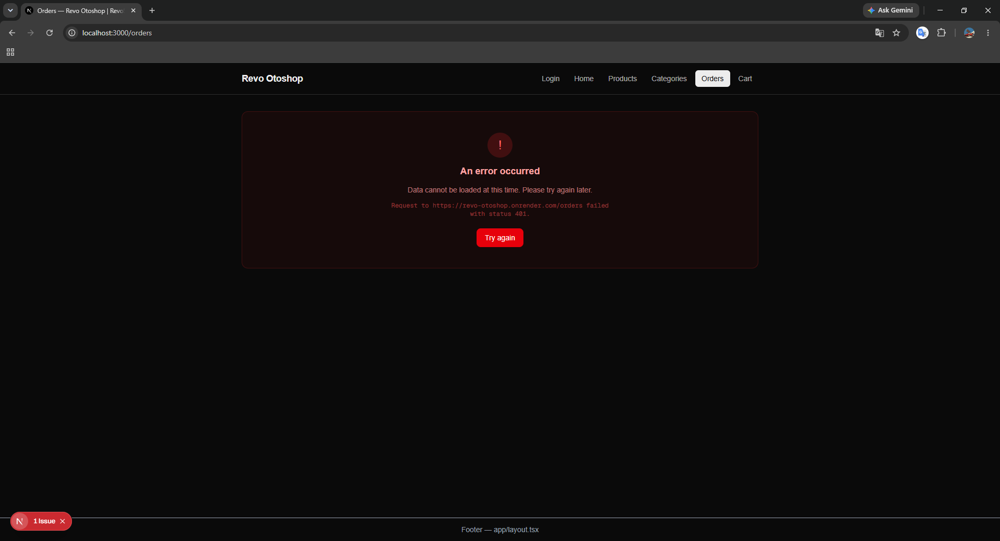

# RevoShop

A [Next.js](https://nextjs.org) storefront (App Router) for an automotive parts shop. Product, category, and order data is served by an external REST API, and authentication (register / login / profile) is handled by the same backend. A client-side shopping cart lets users collect items before checking out, and an admin dashboard provides CRUD management for products, categories, and orders.

## Overview

RevoShop is the frontend for an online automotive parts store ("Revo Otoshop"). It lets shoppers browse a product catalog, filter it with live search, drill into product and category detail pages, and collect items in a cart that survives page reloads. Signed-in users can check out to create an order and review their past orders, while admins get a separate dashboard for managing the catalog and fulfilling orders.

The app is built entirely on the Next.js App Router and talks to an external REST backend for all catalog, order, and auth data. Catalog and category listings are rendered on the server; the cart, auth session, and dashboard interactions run on the client. Route-level `loading`, `error`, and `not-found` states are wired up throughout so every async view degrades gracefully.

## Features implemented

### Storefront

- **Home** — landing view with featured products and entry points into the catalog.
- **Product listing** (`/products`) — full catalog with **live search filtering** as you type.
- **Product detail** (`/products/[id]`) — per-product page with an "add to cart" action; unknown ids resolve to a `not-found` state.
- **Category listing** (`/categories`) — browse all categories, then view the products within each one (`/categories/[categories_id]`).
- **Shopping cart** (`/cart`) — add / remove items and update quantities, persisted to `localStorage` so it survives reloads.
- **Checkout** (`/checkout`) — turns the cart into an order against the API (requires a signed-in user).

### Authentication & account

- **Register** (`/auth/register`) and **Login** (`/auth/login`) — backed by the auth API, with a show/hide password field.
- **Profile** (`/profile`) — signed-in user details, with optional server-side token re-verification.
- **Role-aware UI** — admin vs. customer navigation and access, derived from the user's role.
- Session (token + user) persisted to `localStorage`, so you stay logged in across reloads.

### Orders

- **Orders list** (`/orders`) — a signed-in user's orders (requires a bearer token).
- **Order detail** (`/orders/[order_id]`) — line items and totals for a single order.

### Admin dashboard

- **Dashboard overview** (`/dashboard`) — stats summary, guarded for admin users via `AdminGuard`.
- **Product management** — create, edit, and delete products (`/dashboard/products`, `/dashboard/products/[id]`).
- **Category management** — create, edit, and delete categories (`/dashboard/categories`, `/dashboard/categories/[categories_id]`).
- **Order management** — review and manage orders (`/dashboard/orders`, `/dashboard/orders/[order_id]`).

### App Router states

- Route-level `loading.tsx`, `error.tsx`, and `not-found` handling across the catalog and detail routes.

## Technologies used

- **Next.js 16** (App Router, Turbopack) — routing, server/client components, data fetching, route-level loading/error/not-found states.
- **React 19** — UI components and client interactivity.
- **TypeScript 5** — typed components, API clients, and shared types in `lib/types.ts`.
- **Tailwind CSS 4** — styling.
- **`next/navigation`** — client-side routing primitives (`useRouter`, `usePathname`, `useSearchParams`, `useParams`, `notFound`, `redirect`) used across search, auth, cart, checkout, and dashboard flows.
- **`localStorage`** — session persistence (auth token + user under `token` / `user`) and cart persistence (under `cart`).
- **`NEXT_PUBLIC_API_BASE_URL`** / **`NEXT_PUBLIC_AUTH_BASE_URL`** — public environment variables pointing the catalog and auth API clients at the backend.
- **Playwright** — end-to-end test suite (lives at the repository root; see below).

> Note: user-facing feedback is handled with inline UI states (error cards, loading views) rather than a toast library — there is no `react-hot-toast` dependency in this project.

## Getting started (run locally)

### 1. Install dependencies

```bash
npm install
```

### 2. Configure environment variables

Copy the example file and adjust the values if needed:

```bash
cp .env.example .env.local
```

| Variable                    | Description                                                 |
| --------------------------- | ----------------------------------------------------------- |
| `NEXT_PUBLIC_API_BASE_URL`  | Base URL of the catalog API (products, categories, orders). |
| `NEXT_PUBLIC_AUTH_BASE_URL` | Base URL of the auth API (login, register, profile).        |

Both default to `https://revo-otoshop.onrender.com`. These are `NEXT_PUBLIC_*` values (exposed to the browser), so they must not contain secrets.

### 3. Run the development server

```bash
npm run dev
```

Open [http://localhost:3000](http://localhost:3000) in your browser.

### Available scripts

| Script          | Description                   |
| --------------- | ----------------------------- |
| `npm run dev`   | Start the development server. |
| `npm run build` | Create a production build.    |
| `npm run start` | Serve the production build.   |
| `npm run lint`  | Run ESLint.                   |

## Running the test suite (Playwright)

The end-to-end tests live in the **repository root** (one level above `module-3-cp-2/`), in `tests/`, and are driven by `playwright.config.ts`. The config starts two servers automatically before the suite runs:

1. A dependency-free **mock API** (`tests/mock/server.mjs`) on port `4000`, so tests hit deterministic fixtures instead of the live backend.
2. The **Next.js dev server** (`module-3-cp-2`) on port `3000`, with `NEXT_PUBLIC_API_BASE_URL` and `NEXT_PUBLIC_AUTH_BASE_URL` pointed at the mock.

From the **repository root**:

```bash
# 1. Install Playwright browsers once
npx playwright install

# 2. Run the full suite (starts the mock API + dev server automatically)
npx playwright test

# View the HTML report after a run
npx playwright show-report
```

Useful variations:

```bash
# Run a single spec
npx playwright test tests/auth.spec.ts

# Run only one browser project
npx playwright test --project=chromium

# Run headed / in UI mode for debugging
npx playwright test --headed
npx playwright test --ui
```

Specs cover the main flows: `home`, `products`, `categories`, `cart`, `checkout`, `auth`, `navigation`, `page`, and `protected-routes`. The suite runs against Chromium, Firefox, and WebKit.

## Screenshots

Screenshots of the main views live in [`docs/screenshots/`](./docs/screenshots).

### Home



### Product listing



### Live search & filtering



### Product detail



### Category listing



### Register



### Login



### Admin dashboard



### Loading & error states





## Project structure

```
app/              App Router pages
  page.tsx        Home
  layout.tsx      Root layout (wraps the app in CartProvider, Header, Footer)
  products/       Product list + [id] detail (with loading/error)
  categories/     Category list + [categories_id] detail (with loading/error)
  cart/           Shopping cart page
  checkout/       Checkout page (cart -> order)
  orders/         Orders list + [order_id] detail (requires auth)
  profile/        Signed-in user profile
  auth/           Auth route group (shared layout)
    login/        Login page
    register/     Register page
  dashboard/      Admin management area (shared layout)
    page.tsx      Dashboard overview
    products/     Product CRUD + [id] edit
    categories/   Category CRUD + [categories_id] edit
    orders/       Order management + [order_id] detail
  admin/
    dashboard/    Admin dashboard entry
components/       Reusable UI components
  Header.tsx          Site header with nav and cart indicator
  Footer.tsx          Site footer
  Card.tsx            Generic card container
  ProductCard.tsx     Product tile used in listings
  SearchBar.tsx       Live search input
  PasswordInput.tsx   Password field with show/hide toggle
  AdminGuard.tsx      Client guard that restricts a subtree to admin users
  AddProductForm.tsx / EditProductForm.tsx / DeleteProductForm.tsx     Product CRUD forms
  AddCategoryForm.tsx / EditCategoryForm.tsx / DeleteCategoryForm.tsx  Category CRUD forms
  ErrorState.tsx      Shared error UI
lib/
  api.ts        Catalog API client (products, categories, orders, admin, dashboard stats) + response mappers
  auth.ts       Auth API client (register, login, getMe) + AuthError
  useAuth.ts    useAuth() hook: reads token/user from localStorage, optional server verification, isAdmin, logout
  cart.tsx      Cart context/provider (CartProvider, useCart), persisted to localStorage
  orderForm.tsx Checkout form helpers (fields, validation, shared Field component)
  types.ts      Shared TypeScript types
```

## API notes

- The catalog API returns wrapped responses (`{ products: [...] }`, `{ product: {...} }`, etc.). `lib/api.ts` unwraps these and maps fields such as `image_url` → `imageUrl` and `category_name` → `category`, and converts the string `price` into a number. API failures throw an `ApiError` carrying the HTTP status.
- The `/orders` endpoint requires authentication (`Authorization: Bearer <token>`). Without a valid token the orders page surfaces an error state. Log in first to obtain a token (stored in `localStorage` after login/register).
- Order creation goes through `createOrder(...)`, and the admin dashboard uses `getAdminOrders(...)` and `getDashboardStats(...)`, all of which require a bearer token.
- Authentication lives in `lib/auth.ts` (`register`, `login`, `getMe`) and `lib/useAuth.ts`. `useAuth()` reads the token and user from `localStorage`; passing `useAuth(true)` re-verifies the token against `/me` and logs out on a 401. Admin-only UI is gated by `isAdmin` (derived from `user.role === "admin"`) and the `AdminGuard` component.
- The cart is entirely client-side. `lib/cart.tsx` exposes a `CartProvider` (wired up in the root layout) and a `useCart()` hook, and persists the cart to `localStorage` under the `cart` key so it survives reloads.
- The auth token and user are stored in `localStorage` (under `token` and `user`), which is readable by any script (XSS token-theft risk); migrating the token to an `httpOnly` cookie set by a server route is a recommended future security hardening (deferred).

## Deploy on Vercel

The easiest way to deploy a Next.js app is the [Vercel Platform](https://vercel.com/new). Remember to set `NEXT_PUBLIC_API_BASE_URL` and `NEXT_PUBLIC_AUTH_BASE_URL` in the project's environment variables.

See the [Next.js deployment docs](https://nextjs.org/docs/app/building-your-application/deploying) for details.
